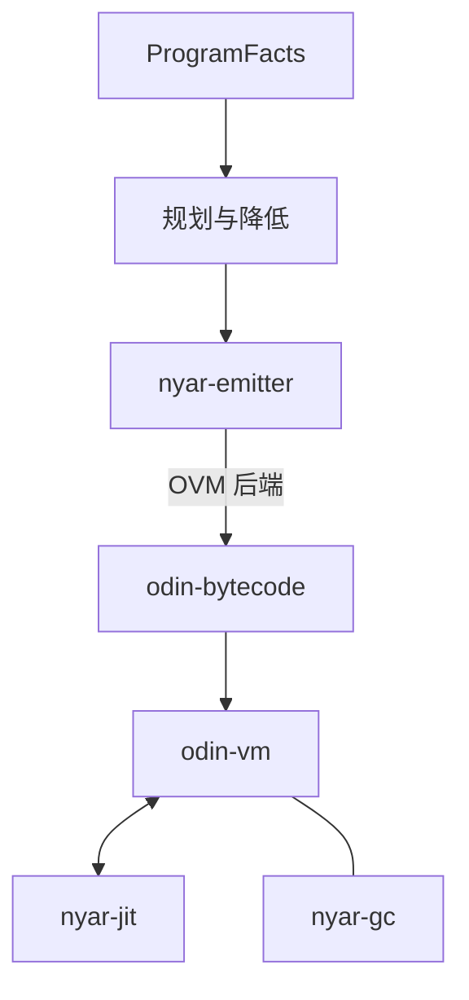
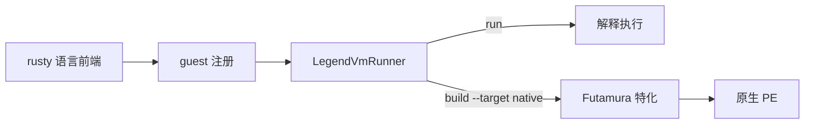

# 运行时与核心组件维护

本仓的运行时维护对象是 **OdinVM** 与 **LegendVM**。二者共享语言中立的边界，但执行模型不同。

## OdinVM

- [odin-vm](../../projects/nyar.rs/runtimes/odin-vm/readme.md)：加载、校验并解释执行 `odin-bytecode` 模块。
- [odin-bytecode](../../projects/nyar.rs/formats/odin-bytecode/readme.md)：`.nyar` 磁盘格式合同。
- [nyar-gc](../../projects/nyar.rs/runtimes/nyar-gc/readme.md)：托管堆、`Value` 与分代标记-清除回收。
- [nyar-jit](../../projects/nyar.rs/runtimes/nyar-jit/readme.md)：即时编译、栈图与去优化。
- [nyar-types](../../projects/nyar.rs/compilers/nyar-types/readme.md)：跨前端/后端的中性身份与合同类型。

AOT 是编译期路径，由 `nyar-emitter` 产出目标产物；运行时侧的优化入口是 `nyar-jit`。

## LegendVM

- [legend-vm](../../projects/nyar.rs/runtimes/legend-vm/readme.md)：guest 注册、解释分发、Futamura 特化与原生产物。
- guest 语言在 `projects/nyar.rs/languages/rusty-{bash,c,lua,powershell,tcl}` 中保留自己的 AST 与解释器。

## 历史设计记录

以下页面记录早期设计，组件命名和实现可能与当前代码不一致，仅用于追溯：

- [nyar-vm.md](./nyar-vm.md)：OdinVM 的早期命名与解释器设计。
- [nyar-ir.md](./nyar-ir.md)：OVM 后端内部 IR 与指令集。
- [nyar-types.md](./nyar-types.md)：早期 NaN-Boxing 值表示；当前 `nyar-types` 是平台合同类型。
- [nyar-aot.md](./nyar-aot.md)：早期 AOT 驱动；当前 AOT 由 `nyar-emitter` 承担。
- [nyar-tools.md](./nyar-tools.md)：早期命令行工具；当前入口为 `odin-vm` CLI。
- [nyar-gc.md](./nyar-gc.md)：早期 GC 设计。
- [nyar-jit.md](./nyar-jit.md)：早期 JIT 设计。

当前实现以各 crate 的 `readme.md`、`tests/` 与源码为准。
