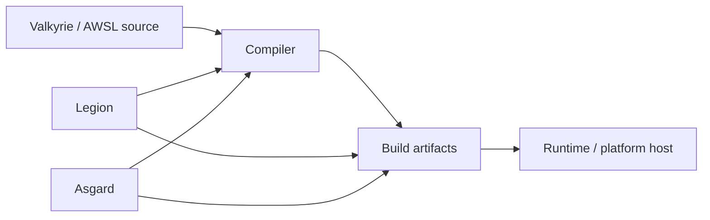

# rusty-valkyrie

`rusty-valkyrie` 是 Valkyrie 的 Rust 产品包，提供语言编译、工程构建和多端交付能力。它支持命令行使用和进程内嵌入，Valkyrie 的 Node-API 产品包也由这里提供实现。

## 能力

- **编译器**：将 Valkyrie 源码解析为语义模型，生成面向 Nyar 平台的编译输入。
- **Legion**：管理工程清单、依赖、构建、测试、缓存和产物。
- **Asgard**：处理 AWSL/Voa 工程，生成 Web、小程序、终端和原生平台交付物。
- **库 API**：为 Rust、Node-API 和测试 harness 提供可复用的编译与工程服务。



## 使用方式

命令行入口适合工程构建和发布流程：

```powershell
cargo run -p rusty-valkyrie --bin legion -- build --help
cargo run -p rusty-valkyrie --bin asgard -- build --help
```

Rust 应用或测试可以使用 `rusty_valkyrie::api` 和 `rusty_valkyrie::legion` 中的库入口。Node.js 应用通过 `@nyar/valkyrie` 使用对应的原生绑定。

编译器实现位于 [`src/compiler`](src/compiler/)，工程能力位于 [`src/legion`](src/legion/)，多端交付位于 [`src/asgard`](src/asgard/)。
