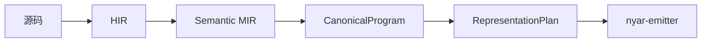

# rusty-valkyrie

Valkyrie 语言的**产品包**：语言前端、`legion` 工程 CLI、`asgard` 多端交付 CLI，以及供宿主嵌入的编译 API。

## 能做什么

- **`legion`**：工作区与清单、多目标编译、测试、文档与包管理相关命令。
- **`asgard`**：从 Voa 工程构建 Web、小程序、终端与原生壳等可发布产物。
- **库**（`rusty_valkyrie::api`）：在进程内使用编译器前端，不把整个 `nyar` 栈 re-export 到 crate 根。

## 编译主链（语义侧）

目标相关的执行计划与编码在 workspace 的 `nyar-emitter` 中完成；本包负责语义闭合与产品入口。



## 构建与测试

```powershell
cargo build -p rusty-valkyrie --bin legion
cargo build -p rusty-valkyrie --bin asgard
cargo test -p rusty-valkyrie --lib
```

可选 feature（诊断 `format-spy`、自举 `bootstrap-lane` 等）见 `Cargo.toml`；默认正式链不依赖它们。

维护者阅读各层说明请打开 crate 内 `src/readme.md` 与对应子目录的 `readme.md`。
