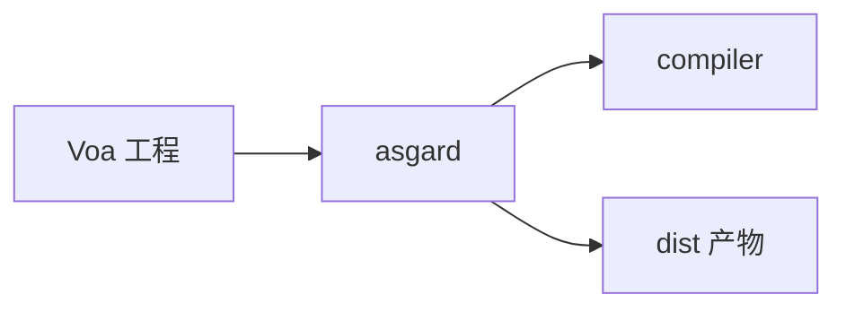

# asgard

**Voa / 多端 UI 交付**：AWSL 与配置解析、RenderIR、按平台生成逻辑/UI 二进制、dist 打包与门禁。用户面向命令为 **`asgard build`** / **`asgard pack`** 等（Rust 侧无独立 asgard binary crate，实现本树 + 包内 `asgard` bin）。

## 与 compiler / legion 的关系

Asgard **没有** 独立语言前端：需要完整语义编译时，直接调用 `crate::compiler::…`（含 `driver`、`emitter`、内部 HIR/MIR）。工程路径与清单约定与 Legion 对齐时可走 `legion::workspace`。

## `codegen` 与 `compiler::emitter` 的区别

| 名称 | 含义 |
|------|------|
| **`asgard/codegen`** | 各 **平台 UI 与壳** 的生成（HTML、小程序、终端、Compose/SwiftUI 桥等） |
| **`compiler/emitter`** | **Nyar / nyar-emitter** 路径：CanonicalProgram、执行计划、字节码或目标 artifact |

二者都叫「生成」，但所有者不同：前者是 **产品交付**，后者是 **语言编译后端适配**。

## 主要子区域（概念）

| 区域 | 作用 |
|------|------|
| `awsl` | AWSL 解析与 RenderIR 降级 |
| `compile` / `pipeline` | 驱动 Asgard 构建管线 |
| `codegen` | 平台相关 UI/运行时胶水 |
| `delivery` / `package` / `deploy` | 打包、发布与部署计划 |
| `platform_contract` | 平台门禁与占位检测 |
| `config` / `host` | Voa 配置与宿主能力 |

## 错误

操作失败使用 `AsgardError` 等领域枚举；用户可见汇总经 `utilities::report`，见 [`utilities/readme.md`](../utilities/readme.md)。
