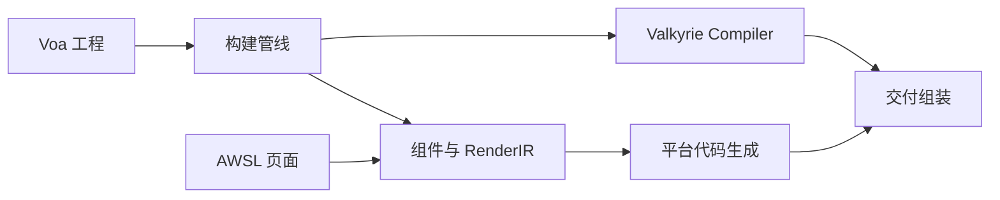

# Asgard

Asgard 将 Voa 工程配置、AWSL 页面和 Valkyrie 逻辑组织成平台交付物。页面首先形成组件与 RenderIR，代码生成器据此生成界面和宿主桥接，构建管线汇总编译结果与交付资源。

## 模块协作

`awsl` 处理页面与组件结构；`compile` 连接逻辑编译，`pipeline` 保留源码发现；`codegen` 包含 Web、小程序、终端及原生 UI 的生成器；`delivery` 汇总资源和平台文件。

配置发现（C1）与严格模型（C2）已落地（`config_discovery` / `config_model`），求值器未闭合前不读取配置内容。`host` 描述宿主能力，`platform_contract` 检查产物结构，`deploy` 和 `publish` 提供部署与发布操作。

Asgard 使用 Compiler 分析 Valkyrie 源码，通过 Legion 的工程设施定位依赖。平台 UI 和宿主胶水在 `asgard/codegen` 中生成，语言产物的 Nyar 适配在 `compiler/emitter` 中完成。操作错误使用 `AsgardError` 表达。
