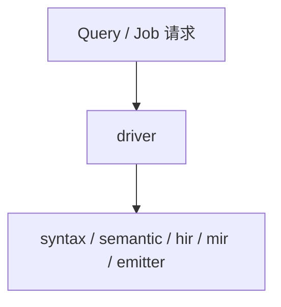

# compiler / driver

**编译调度与查询**：决定「当前请求要跑哪些阶段」，不把语义算法塞满本目录。

## 职责

- 组装 `compile` job：入口闭包 → HIR → MIR → emitter 路径。
- 支持 **按需求查询**（语言服务）：hover、references、diagnostics 等不必每次都降到 MIR（与 `services` 协同）。
- `validation` 子模块：跨 HIR/MIR 的一致性编排（算法仍在 `hir`/`mir`）。

## 非职责

- 不实现类型推断、overload 选择、MIR 指令选择。
- 不把 `hir/lowering/mod.rs` 整文件迁来改名；应把 **编排** 留在此处，把 **生产者** 留在 `semantic`/`hir`/`mir`。

## 增量编译（骨架）

[`incremental.rs`](incremental.rs) 仅定义 `InputRevision` 与 `InvalidationGraph` 占位 API：后续按「事实层依赖」填充失效规则，不在此目录做缓存策略产品化。

