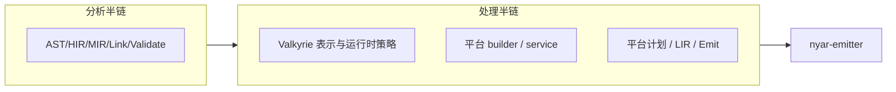

# compiler / emitter

**Valkyrie×目标适配与编译后半段编排**：消费本语言 Semantic MIR / link 结果，选择显式表示策略和运行时包装，调用平台代码服务并组织 artifact bundle。语言语义留在 Valkyrie，平台计划、LIR、指令、编码与容器归相应平台所有。

命名 **emitter** 是为了与 workspace 包 `nyar-emitter` 一致；此处 **不是** Asgard 里的 UI `codegen`（Vue/小程序壳生成），后者在 `asgard/codegen`。

## 子模块

| 模块 | 作用 |
|------|------|
| `pipeline` | 分析/处理流编排：`compile_source_groups_to_*`、阶段证据、host binding |
| `assembly` | 片段装配与产出面计数 |
| `backend_contract` | 目标互操作与导入面合同 |
| `frontend_contract` | MIR 类型具体化等 **Valkyrie→目标** 适配（非 Oak AST） |

## 阶段划分（概念）

`pipeline` 文档中的 `StreamHalf`（Analysis vs Processing）与此对应：本目录 **消费** 已闭合的 Valkyrie 语义事实，**不** 向上补类型或绑定。平台可以向适配器暴露受验证的 LIR builder/service；API 中出现平台 LIR 并非越界，重新定义平台指令或绕过平台验证才是越界。

Valkyrie 语义载荷（`ValkyrieMirProgram` / `CompiledValkyrieProgram`）已迁入本语言 crate；正式接入口只接受 `AdaptedFragmentInput` 适配器，不保留共享语义子集入口。共用 `TargetExecutionPlan` 按平台拆分仍是未完成工作。

## 依赖方向

- 依赖：`compiler::{hir,mir,semantic,types}`、`nyar` 和 `nyar-emitter`。
- 名称解析和 evidence 选择由 `semantic` 产生，本模块消费已解析的结果。
