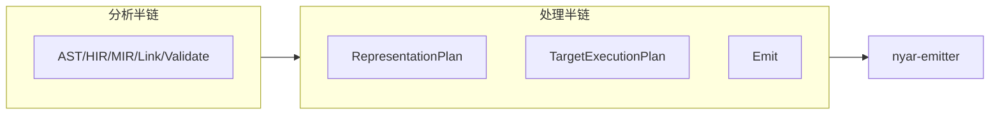

# compiler / emitter

**Nyar 合同适配与编译后半段编排**：从 Semantic MIR / link 结果到 `CanonicalProgram`、表示规划、以及交给 `nyar-emitter` 的 artifact bundle。

命名 **emitter** 是为了与 workspace 包 `nyar-emitter` 一致；此处 **不是** Asgard 里的 UI `codegen`（Vue/小程序壳生成），后者在 `asgard/codegen`。

## 子模块

| 模块 | 作用 |
|------|------|
| `pipeline` | 分析/处理流编排：`compile_source_groups_to_*`、阶段证据、host binding |
| `assembly` | 片段装配与产出面计数 |
| `backend_contract` | 目标互操作与导入面合同 |
| `frontend_contract` | MIR 类型具体化等 **语言→Nyar 输入** 适配（非 Oak AST） |

## 阶段划分（概念）

`pipeline` 文档中的 `StreamHalf`（Analysis vs Processing）与此对应：本目录 **消费** 已闭合的语义事实，**不** 向上补类型或绑定。

## 依赖方向

- 允许依赖：`compiler::{hir,mir,semantic,types}`、`nyar`、`nyar-emitter`（workspace）。
- 禁止：`emitter` 内实现名称解析或 evidence 选择（应查询 `semantic` 结果）。
