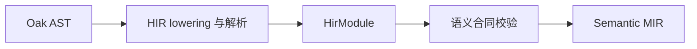

# 高层中间表示

HIR 将 Oak AST 转成编译器使用的高层程序模型，保留声明、类型、函数、表达式和控制流信息。这里包含模型构造、名称与调用解析，以及进入 MIR 之前的语义检查。

`lowering` 提供 `ValkyrieCompiler` 和 AST 到 HIR 的构造流程；`call_binding`、`construct_binding`、`overload` 处理参数、构造与重载选择；`nominal_registry`、`trait_system`、`type_relation` 支持类型及 trait 分析；控制流、捕获和传播表达式由对应模块处理。

模型定义由 [types/hir](../types/hir/readme.md) 提供，并在本模块再导出。跨源码组的需求闭包见 [semantic](../semantic/readme.md)，SSA 构造见 [mir](../mir/readme.md)。
