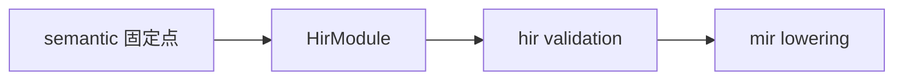

# compiler / hir

**已解析高层 IR（HIR）**：语言语句、表达式、名义类型在语义固定点之后的 **模型与合同**。

## 内部分层

| 区域 | 职责 |
|------|------|
| `types`（经 `compiler/types/hir` 载体） | HIR 数据结构定义（向 `hir/model` 单一化收敛） |
| `lowering` | AST→HIR 片段、**历史上** 的编译 façade（`ValkyrieCompiler` 正在迁往 `compiler/api` + `driver`） |
| `overload`、`type_relation`、`trait_system` 等 | 算法实现；长期归 `semantic`，HIR 只保留模型与验证 |
| `validation` 合同 | 跨模块 HIR 合同（与 `driver/validation` 区分：后者编排多阶段） |

## 不变量

- 进入 MIR 的 HIR 必须通过语义合同校验；缓存反序列化后仍须 `validate_hir_semantic_contract` 类检查。
- HIR 表达式/语句 **不** 与 `semantic` 层类型身份混放：通用类型身份归 `semantic`，HIR 节点归本树。

## 相关文档

- MIR：[`../mir/readme.md`](../mir/readme.md)
- 共享 span/诊断壳：[`../types/readme.md`](../types/readme.md)
