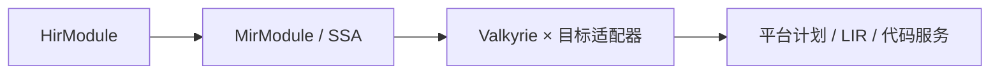

# compiler / mir

**Semantic MIR**：带语义与 effect 信息的中间表示，由 Valkyrie 自己定义与验证，再交给 `emitter` 做语言×目标适配。它不承诺适用于其它语言，也不成为 Nyar 通用 MIR。

## 职责

- **模型**：函数、块、值、指令、terminator（见子模块与 [`ssa/readme.md`](ssa/readme.md)）。
- **lowering**：从已验证 HIR 构造 MIR；共享 lowering 上下文，但不持有 Legion/Asgard 产品状态。
- **validation**：MIR 阶段合同、与 HIR 一致性、link 前校验。

## 与 HIR / emitter 的边界

- MIR **不** 编码目标指令或寄存器分配；那是 Nyar 后端与目标 lowering 的所有权。
- 单例语义、类型身份和聚合成员等语言事实由 Valkyrie 生产；物理布局由目标策略及平台合同确定，不在下游按名称猜测。
- 当前 canonical 载荷承载本语言语义，必须改名并归还 Valkyrie。适配器可使用平台受验证 builder/service 构造平台计划或 LIR，MIR 自身不复制这些模型。

## 优化

语言语义优化若作用于 MIR，实现放在 [`../optimization/readme.md`](../optimization)；须声明接受的 IR 形态与失效的分析。
