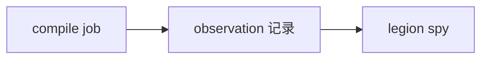

# compiler / observation

**可观测编译事实**的合同层，供 Legion `spy` 与子命令查询：输入修订、声明身份、需求链、绑定/evidence 选择、HIR/MIR 视图、emitter 阶段结果等。

## 原则

- 观测走 **正式编译链**上已执行的阶段；未请求或未执行的阶段返回「未采集」，**不** 为展示另跑语义旁路。
- `spy` 负责过滤、关联与呈现；本目录定义 **事实形状** 与采集钩子。

新增 IR 节点或优化 pass 时，在此补充对应观测适配，而不是新增 `dump_*.rs` 二进制工具。

