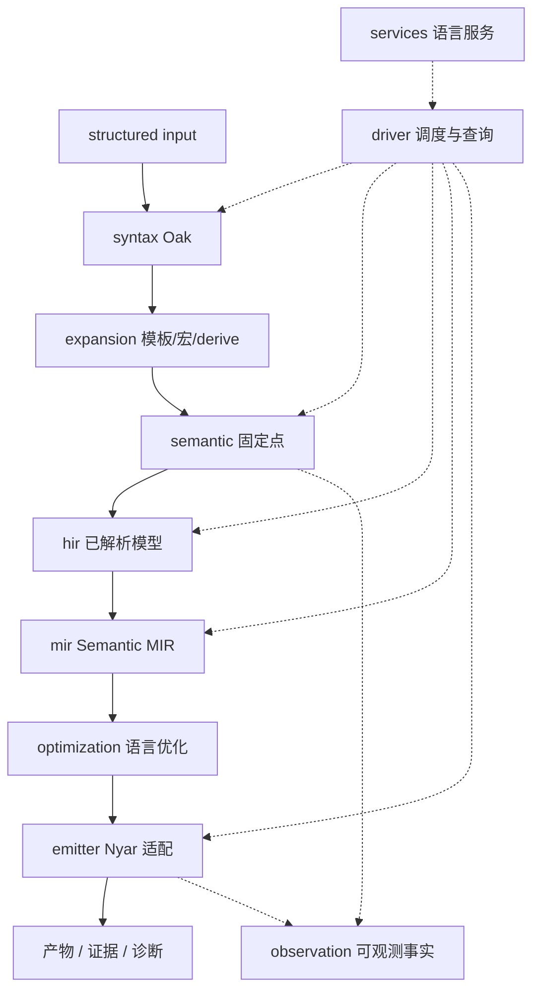
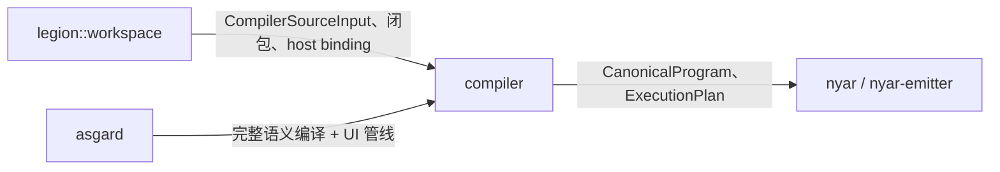

# Compiler

`compiler` 是 Valkyrie 的语言编译器。它消费 Oak 产生的语法树和源位置，将声明、类型、调用、控制流与 evidence 组织成可验证的 Semantic MIR，再向 `nyar-emitter` 提供目标相关的编译输入。

## 端到端数据流

## 子模块

| 模块 | 内容 |
|------|------|
| `api` | 库调用的请求、结果和窄出口 |
| `input` | 编译输入和源码快照的边界类型 |
| `syntax` | Oak 解析会话、源映射和语言配置 |
| `expansion` | 模板、derive、路由和元数据展开 |
| `semantic` | 声明、作用域、类型、调用、evidence 和需求闭包 |
| `types` | 跨阶段共享的源位置、诊断和类型容器 |
| `hir` | 已解析 HIR 模型、lowering 和验证 |
| `mir` | Semantic MIR、SSA、lowering 和验证 |
| `optimization` | HIR/MIR 语义保持变换 |
| `emitter` | CanonicalProgram、表示规划和 Nyar 适配 |
| `driver` | 阶段验证编排与输入修订接口 |
| `services` | 格式化注册、lint 和高亮 |
| `diagnostics` | 公共诊断类型出口 |
| `observation` | 观测会话类型 |

## 库入口

`compiler::api` 集中提供编译器嵌入方需要的请求、结果和查询类型。Rust 应用、Legion、LSP 和 Node-API 通过这里共享编译器能力；具体算法仍由 `syntax`、`semantic`、`hir`、`mir` 和 `emitter` 实现。

## 与其它树的关系

Asgard 使用 Compiler 编译生成的 Valkyrie 逻辑，工程上下文由 Legion 提供。
