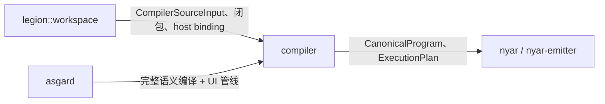

# compiler

Valkyrie **语言编译器**实现：从 Oak 语法事实到 Semantic MIR，再按目标选择 Nyar 模块的输入合同，交给 workspace 内的 `nyar-emitter` 完成表示规划与编码。

本树 **不是** Legion 工程层，也 **不是** Asgard UI 产品生成层。Legion/Asgard 通过 `crate::compiler::…` 调用内部组件；稳定对外 façade 在 [`api.rs`](api.rs)，由 crate 根 `rusty_valkyrie::api` 再导出。

## 设计原则

1. **目录 = 事实所有者**；**driver = 执行顺序**。不能把绑定、推断、evidence 拆成互不协作的「流水线文件夹」。
2. **声明索引不必等全部 body 成功**；入口驱动的需求固定点扩展闭包（见 [`semantic/readme.md`](semantic/readme.md)）。
3. **没有万能 Canonical IR 中心**：选中哪个 Nyar 后端，就满足该后端的输入合同（[`emitter/readme.md`](emitter/readme.md)）。
4. **Oak 拥有 AST**；本树 `syntax` 只做接入、源映射与 Valkyrie 命名规则，不复制 AST 定义。
5. 模块名 **`emitter`** 对齐 `nyar-emitter` 所有权；避免再建一层含义模糊的 `codegen` 产品目录。

## 端到端数据流

## 子目录职责

| 目录 | 职责 | 文档 |
|------|------|------|
| `api` | 对外请求/结果类型与窄 re-export（`api.rs`） | 本页「对外 API」 |
| `input` | 不可变编译输入、与 Legion 快照的边界类型 | [`input/readme.md`](input/readme.md) |
| `syntax` | Oak 解析会话、`oak_valkyrie::ast` 桥接、源种类 | [`syntax/readme.md`](syntax/readme.md) |
| `expansion` | 结构化模板、derive、路由/图注入等语言展开 | [`expansion/readme.md`](expansion/readme.md) |
| `semantic` | 声明/作用域/类型/绑定/evidence/需求固定点 | [`semantic/readme.md`](semantic/readme.md) |
| `types` | 跨阶段共享的 span、诊断壳、**暂存**的 HIR 类型载体（向 `hir/model` 收敛） | [`types/readme.md`](types/readme.md) |
| `hir` | 已解析 HIR 模型、elaboration、合同校验 | [`hir/readme.md`](hir/readme.md) |
| `mir` | Semantic MIR 模型、降低、校验 | [`mir/readme.md`](mir/readme.md) |
| `optimization` | 语言语义优化（HIR / MIR） | [`optimization/readme.md`](optimization/readme.md) |
| `emitter` | CanonicalProgram、表示规划、与 `nyar-emitter` 的 bundle | [`emitter/readme.md`](emitter/readme.md) |
| `driver` | 阶段调度、部分校验编排、增量骨架 | [`driver/readme.md`](driver/readme.md) |
| `services` | 补全、跳转、诊断等编辑器能力 | [`services/readme.md`](services/readme.md) |
| `diagnostics` | 跨层诊断关联与展示辅助 | [`diagnostics/readme.md`](diagnostics/readme.md) |
| `observation` | Legion `spy` 消费的编译观测合同 | [`observation/readme.md`](observation/readme.md) |

## 对外 API（`api.rs`）

`api` 模块集中 **库嵌入方** 需要的类型：例如 `ValkyrieCompiler`、语义闭包规划、emitter pipeline 入口、格式化/lint 注册、核心 MIR/HIR 视图等。新增对外能力应先定义请求/结果，再实现于子模块，最后由 `api` 导出；避免在 crate 根 `pub use hir::*` 式通配出口。

## 与其它树的关系

Asgard **可以** 调用任意 `compiler` 内部模块（无独立 binary）；仍应优先走明确的 driver/query，而不是复制 lowering 私有状态。
