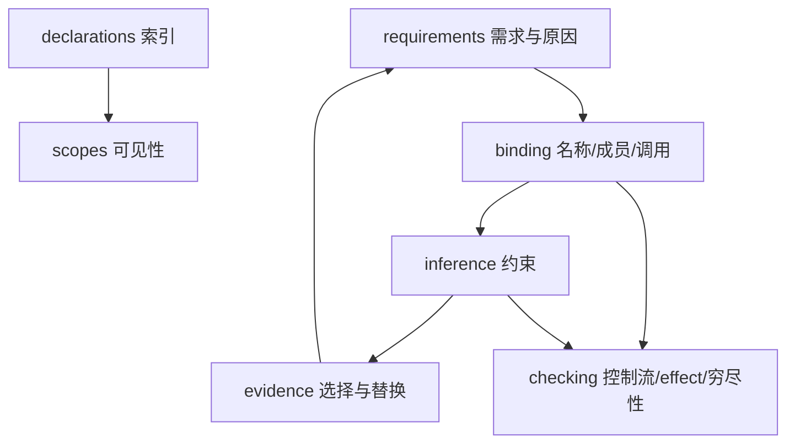

# compiler / semantic

**同一套语义事实系统**的协作模块：声明、可见性、类型、绑定、evidence 与入口需求在固定点中互相推进，而不是按目录顺序线性「先全绑定再全推断」。

## 固定点（概念）

语义闭包是固定点计算的结果。发现新实例或 evidence 需求时，计算会继续访问同一作用域和声明索引。

## 代码区域

| 目录/模块 | 目标职责 |
|-----------|----------|
| `closure` | 入口语义闭包规划（`semantic_closure` 迁入） |
| `typing` | 类型线性化、继承分析等 |
| `type_checker` | 语义检查与类型判定入口 |
| `control_flow` | 控制流协议与调度相关语义 |
| `module` | 模块图与声明归属 |
| `operator_members` | 运算符成员名（运算符是普通成员调用） |

重载、类型关系和控制流验证目前主要位于 `hir`，与这里的闭包、模块和类型检查协作完成语义分析。

## 边界

- **不** 实现 Nyar 表示或 ABI 具体化（那是 `emitter::frontend_contract` 一类适配）。
- **不** 编排整次编译（`driver`）。
- 错误由本层事实生产者定义种类；统一关联与呈现见 `compiler/diagnostics`。
