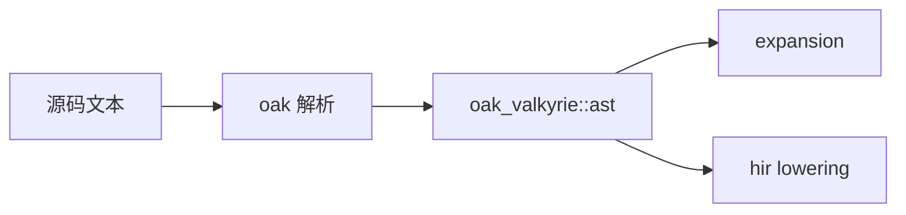

# compiler / syntax

**Oak 语法接入层**：把源码文本变成可供编译器消费的语法事实与源映射。

## 所有权

- **AST 类型** 属于 Oak（`oak_valkyrie::ast`）。本目录的 `oak` 子模块（原语法桥接）提供解析会话、生产语言配置、以及 `ValkyrieRoot` 等别名。
- **不属于** Nyar，也 **不是** 名为 `frontend` 的「第二套前端产品」。

## 子模块

| 模块 | 作用 |
|------|------|
| `oak` | 解析入口、`ParseError`、命名规范校验、模板源拒绝策略 |
| `parser` | 文本解析 façade（委托 `oak`） |
| `source_surface` | 扩展名与 `SourceKind`（Valkyrie / VON / AWSL 等） |
| `source_format` | 与格式化相关的源面辅助 |

## 下游消费者

- `expansion`：在结构化节点上展开模板和宏。
- `semantic` / `hir`：消费 Oak AST 与源位置，直接生成 Valkyrie 语义模型。

