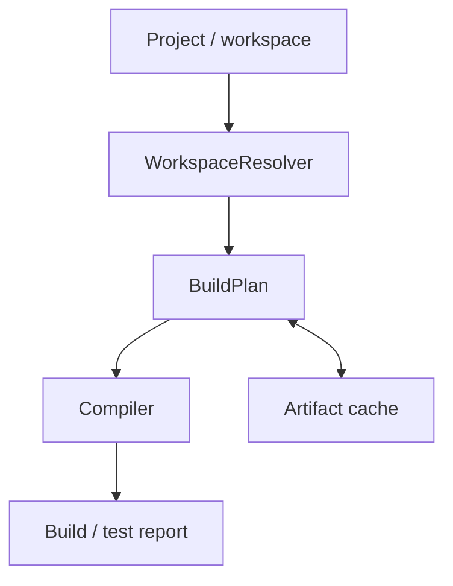

# legion

`legion` 是 Valkyrie 的工程服务：清单与工作区、依赖规划、源码快照、构建缓存、产物装配，以及 `build`、`test`、`spy`、`doc` 等工程操作。命令行、Rust API 和 Node-API 共享这套实现。

## 工程数据流

- **`workspace`**：解析 `legion.von` / `legions.von`、依赖图、构建计划和源码快照。
- **`cache`**：编译输入摘要、产物索引与复用。
- **`cmds`**：子命令实现；[`cmds/readme.md`](cmds/readme.md) · 观测 [`cmds/spy/readme.md`](cmds/spy/readme.md)。
- **`api`**：`plan` / `compile` / `compile_project`；N-API 与测试直接调用，无 argv CLI。

## 类型与产品关系

`legion` 使用 `CanonicalTarget`、发布格式和 Runner 等 Nyar 类型组织工程请求与产物。

## 与其它模块

Legion 管理工程上下文，Compiler 负责语言语义和编译，Asgard 复用工程布局并负责平台交付。

## LSP

语言服务进程相关代码在 [`lsp/`](lsp/readme.md)（若启用）；语义事实仍来自 `compiler::services` + `driver` 查询。
