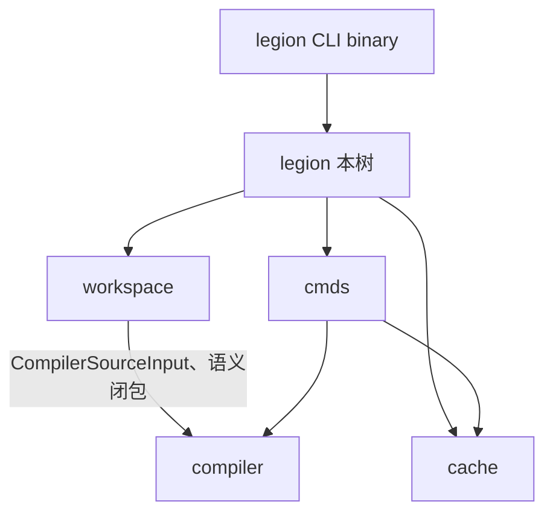

# legion

**Valkyrie 工程与 CLI 库实现**：清单与工作区、依赖规划、源码快照、构建缓存、产物装配，以及 `legion` 子命令（build、test、spy、doc 等）。

## 在包内的位置

- **`workspace`**：解析 `legion.von` / `legions.von`、依赖图、构建计划、源码快照（`source_snapshot`）。工程事实 **归 Legion**，不归 `compiler::input` 解析清单。
- **`cache`**：编译缓存键、artifact 解析与复用。
- **`cmds`**：子命令实现；[`cmds/readme.md`](cmds/readme.md) · 观测 [`cmds/spy/readme.md`](cmds/spy/readme.md)。
- **`api`**：`build_project` / `plan_project` 等库入口，供 CLI 与测试调用。

## 目标与 Nyar 类型

`legion` 对 **CanonicalTarget**、发布格式、Runner 等类型通过 **`nyar`** 直接导出（见 `legion/mod.rs`），crate 根 **不** 通配 re-export `nyar`。

## 与 Asgard

Asgard 构建可复用 Legion 的工程布局约定；交付打包由 `asgard` 拥有，Legion 负责通用 Valkyrie 包编译链。

## LSP

语言服务进程相关代码在 [`lsp/`](lsp/readme.md)（若启用）；语义事实仍来自 `compiler::services` + `driver` 查询。
