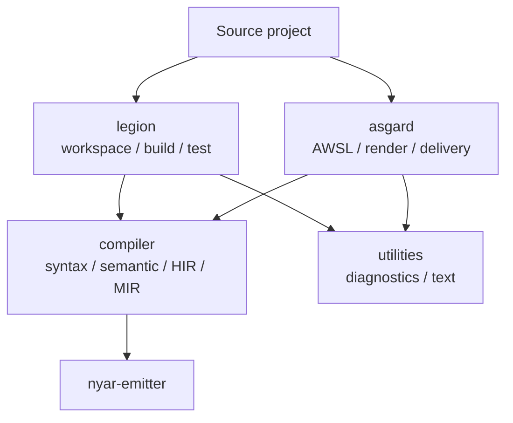

# `rusty-valkyrie/src`

这里是 `rusty-valkyrie` 单一 Cargo 包的实现根。模块按职责组织：`compiler` 处理语言语义，`legion` 处理工程，`asgard` 处理多端交付，`utilities` 提供跨模块共享的基础服务。

## 模块

| 目录 | 回答的问题 |
|------|------------|
| [`compiler/`](compiler/readme.md) | Oak 语法接入、模板展开、语义分析、HIR、Semantic MIR 和 Nyar 编译适配 |
| [`legion/`](legion/readme.md) | 工程清单、依赖解析、源码快照、构建计划、缓存、测试和产物管理 |
| [`asgard/`](asgard/readme.md) | AWSL/Voa 解析、RenderIR、平台代码生成、打包和部署 |
| [`utilities/`](utilities/readme.md) | 诊断投影、报告格式化和无领域语义的文本服务 |

## 对外入口

- `rusty_valkyrie::api`：编译器和语言服务的库入口。
- `rusty_valkyrie::legion`：工程规划、构建和测试的库入口。
- `rusty_valkyrie::asgard`：Voa/AWSL 交付能力的库入口。
- `src/bin/legion.rs`、`src/bin/asgard.rs`：命令行入口。
