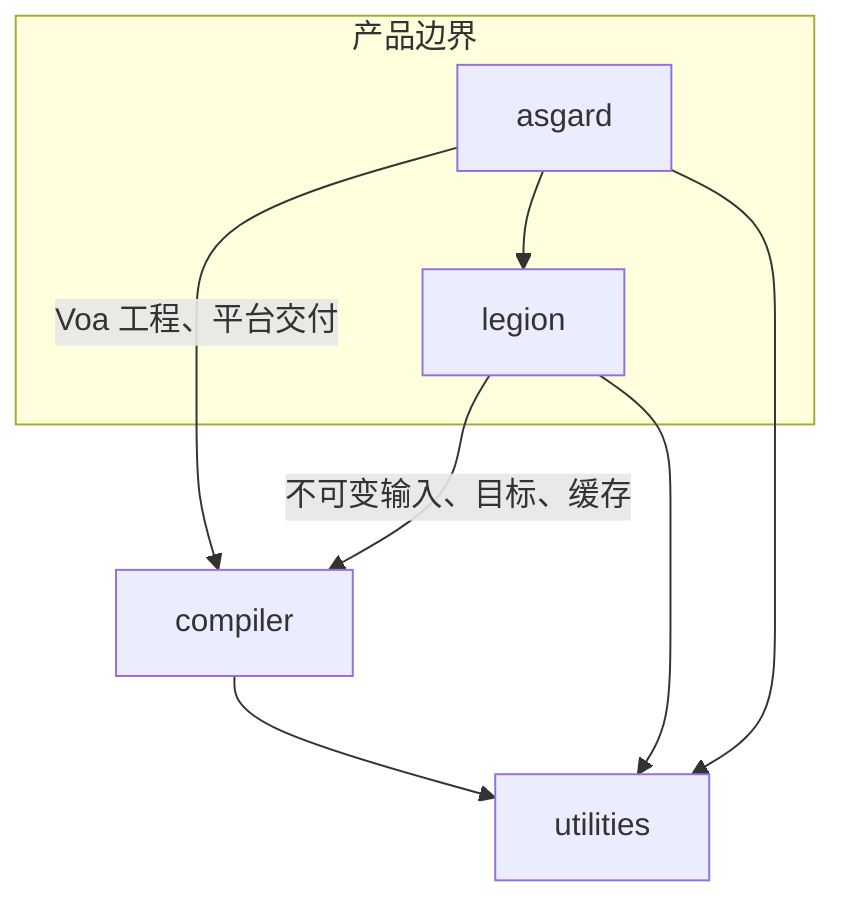
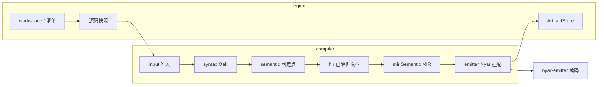

# `rusty-valkyrie` 源码根

本目录是 **单一 Cargo 包** 的实现根：对外仍是一个 `rusty-valkyrie` 库，内部按 **所有者** 分为四棵模块树，而不是按「编译阶段文件夹顺序」假装流水线。

## 四棵模块树各自回答什么问题

| 目录 | 回答的问题 |
|------|------------|
| [`compiler/`](compiler/readme.md) | Valkyrie **语言**如何从 Oak 源码走到 Semantic MIR，以及如何按所选 Nyar 合同交给 `nyar-emitter`。 |
| [`legion/`](legion/readme.md) | **工程**如何解析、规划依赖、编译、测试、缓存产物与观测（`legion` CLI 的库实现）。 |
| [`asgard/`](asgard/readme.md) | **Voa/多端 UI** 如何从 AWSL/配置走到可发布 dist（无独立 Rust binary；复用 compiler 全链）。 |
| [`utilities/`](utilities/readme.md) | 跨树共享、**不拥有业务决策** 的诊断出口与文本小工具。 |

## 编译事实流（与目录顺序无关）

目录表达 **谁拥有哪种事实**；**执行顺序** 由 `compiler::driver` 与 Legion 构建入口调度。语义上从工程到产物的数据流如下：

## 对外 API 入口

- **终端用户** 看 crate 根 [`readme.md`](../readme.md)。
- **库嵌入** 使用 `rusty_valkyrie::api`（定义在 `compiler/api.rs`），crate 根 **不** re-export 整个 `nyar`；目标与清单相关类型由 `legion` 按需导出。
- **语言服务** 属于 `compiler::services`，与正式构建共享查询与事实，见 [`compiler/services/readme.md`](compiler/services/readme.md)。

## 子目录文档索引

- Compiler 分层：[`compiler/readme.md`](compiler/readme.md)
- Legion 命令与 workspace：[`legion/readme.md`](legion/readme.md) · [`legion/cmds/readme.md`](legion/cmds/readme.md)
- Asgard 交付：[`asgard/readme.md`](asgard/readme.md)
