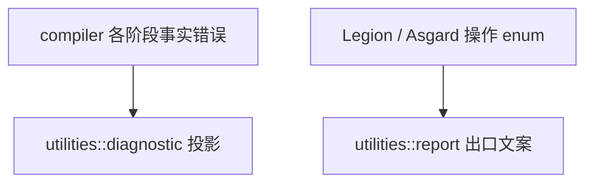

# utilities

与 **Compiler / Legion / Asgard 业务决策无关** 的横切能力：结构化诊断出口、命令行短句、无领域语义的文本辅助。

Utilities 只包含被 Compiler、Legion、Asgard 共同使用的基础服务，不保存类型、闭包、缓存键或平台模型等领域状态。

## 子模块

| 模块 | 作用 |
|------|------|
| **`diagnostic`** | 对 `boost_diagnostic` 的 re-export；编译器与 LSP 挂接带 span、code、related 的诊断事实。 |
| **`report`** | `report!`、`report_msg`、`display_failure`：在 CLI 或绑定层 **出口** 把已决定的失败收成用户可见文案。 |
| **`text`** | 无领域语义的字符串/文本小工具。 |

## 错误分层

- 编译期语义在 `compiler` 用 `ValkyrieError` 等表达；宿主展示前可投影为 `boost_diagnostic::Diagnostic`。
- Legion/Asgard 库函数返回各自领域错误，在 CLI 或 N-API 层由 `display_failure` 生成展示文本。
- `report` 只负责展示，不参与领域错误的产生。

格式化、lint、语义着色归属 **`compiler::services`**；Oak 提供语法事实与 edits。`utilities` 至多提供中性文本机制。

## 宏

全 crate 可通过 `lib.rs` 的 `#[macro_use]` 使用 `report!`；勿把 `report` 当普通函数从子模块导入。
