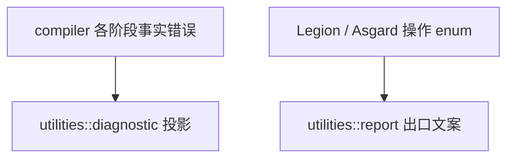

# utilities

与 **Compiler / Legion / Asgard 业务决策无关** 的横切能力：结构化诊断出口、命令行短句、无领域语义的文本辅助。

## 准入条件（四则）

1. 已有 **跨树** 真实调用方。
2. **不** 拥有任何一方的业务决策（类型、闭包、cache key、平台模型等）。
3. **不** 依赖上层模块（仅下层或外部 crate）。
4. 名称能说明 **具体用途**，禁止 `helpers` / `manager` 垃圾场。

## 子模块

| 模块 | 作用 |
|------|------|
| **`diagnostic`** | 对 `boost_diagnostic` 的 re-export；编译器与 LSP 挂接带 span、code、related 的诊断事实。 |
| **`report`** | `report!`、`report_msg`、`display_failure`：在 CLI 或绑定层 **出口** 把已决定的失败收成用户可见文案。 |
| **`text`** | 无领域语义的字符串/文本小工具。 |

## 错误分层

- 编译期语义在 `compiler` 用 `ValkyrieError` 等表达；渲染前可投影为 `boost_diagnostic::Diagnostic`。
- Legion/Asgard 库函数返回 `LegionError` / `AsgardError` 等，在 `main` 或 N-API 层 `display_failure`。
- `report` **不** 参与库内 `Result<T, String>` 别名。

格式化、lint、语义着色归属 **`compiler::services`**；Oak 提供语法事实与 edits。`utilities` 至多提供中性文本机制。

## 宏

全 crate 可通过 `lib.rs` 的 `#[macro_use]` 使用 `report!`；勿把 `report` 当普通函数从子模块导入。
