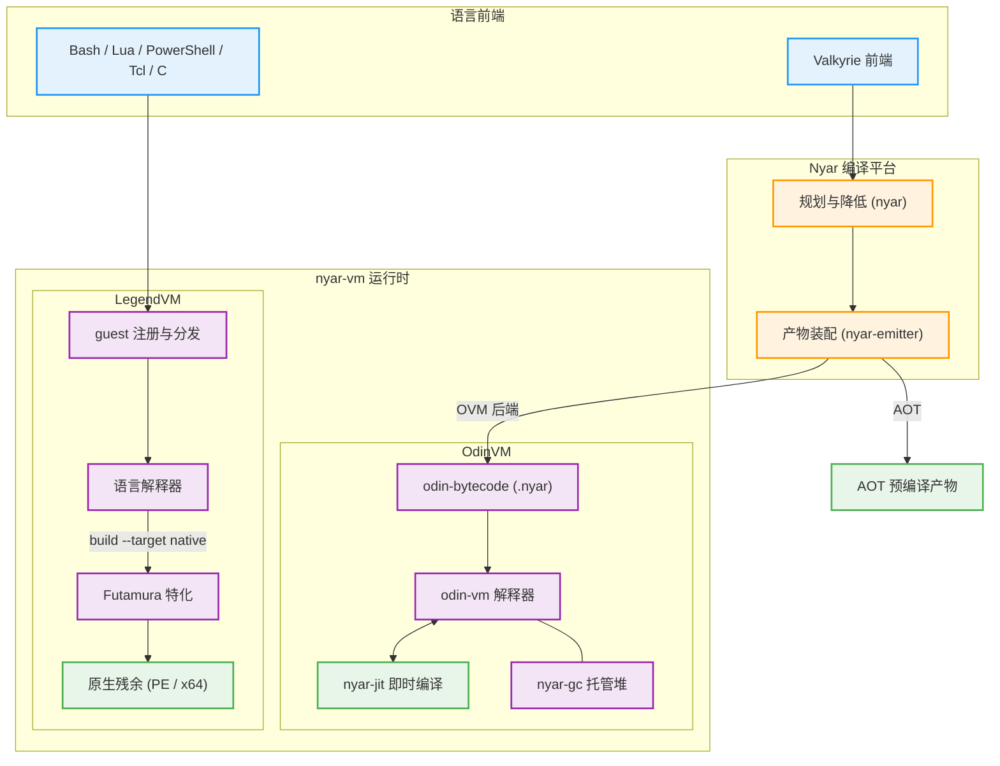
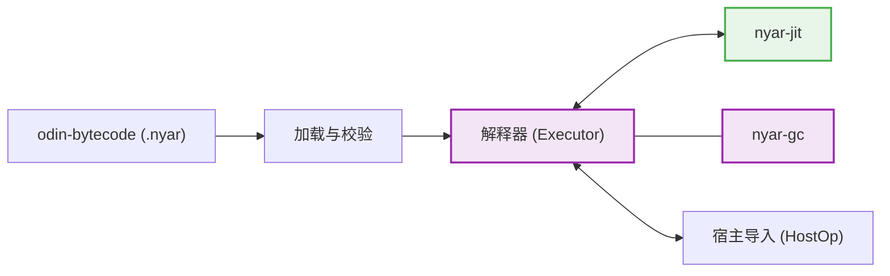
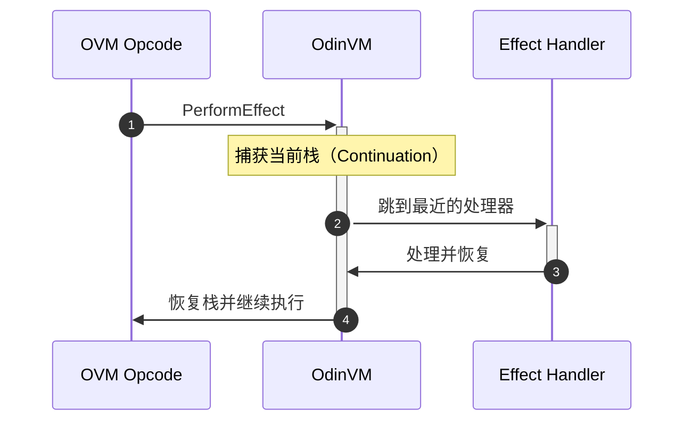
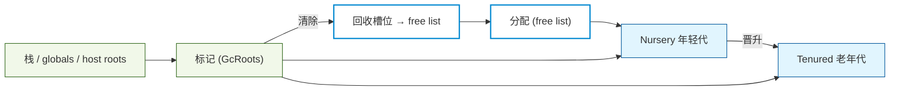
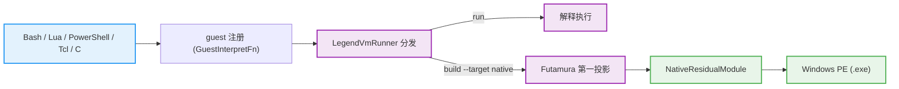
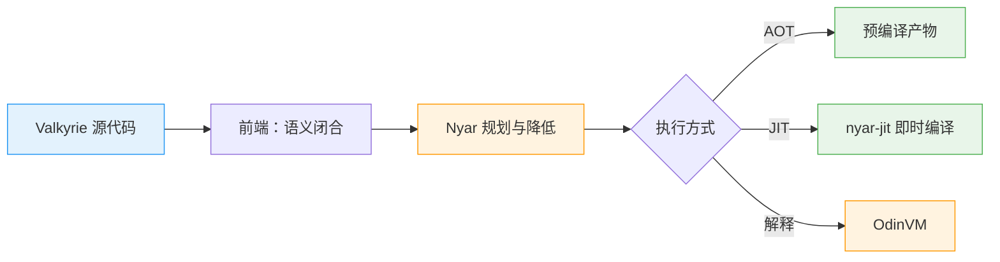
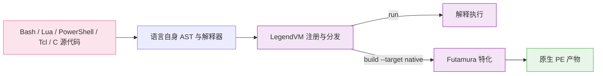

# Nyar VM

## 💡 什么是 nyar-vm？

**Nyar VM** 是一套现代化的高性能运行时，主要包括两种场景：

- **OdinVM**：高性能的栈式 VM，加载 `.odin` 字节码，支持并发式无停顿 GC 和自适应 Jit 加速。
- **LegendVM**：在 OdinVM 基础上构建的解释型运行时，可通过 Futamura 映射生成独立二进制分发。

两个运行时都以语言中立为前提：语言语义属于各自的前端，运行时只消费已经闭合的输入。

## 🏗️ 整体架构

---

## ⚙️ OdinVM

OdinVM 执行 OVM 后端的产出：前端语义闭合后，经 Nyar 平台降低为 `nyar-ir`，再由 `nyar-emitter` 装配成 `odin-bytecode` 模块。运行时只看到已编码、已验证的模块，不接触任何语言的 AST 或解析器。

### 执行模型

### 核心特性

- **字节码解释**：栈式指令循环、调用帧、模块初始化函数与全局槽。模块加载时校验结构、解析导出符号。
- **宿主导入**：通过 `CallImport` 与 `host` 模块的 `HostOp` 派发调用宿主能力。
- **代数效应**：`PerformEffect` 挂起当前上下文，交由最近的处理器恢复。
- **异步与协程**：`Yield` / `Resume` 在托管堆上保存和恢复协程状态。
- **即时编译**：`nyar-jit` 通过 `Executor::with_jit` 注入，按栈图编译热点函数，假设失效时去优化回解释器。
- **标量快路径**：NJ1 小规模标量程序可直接编译执行，并在解释器内缓存编译结果。
- **内存管理**：`nyar-gc` 提供托管堆、分代标记-清除回收与宿主根。
- **AOT**：编译期的 `nyar-emitter` 直接把程序编译为目标产物；运行时侧对应的是 JIT 的即时优化。

#### 代数效应

#### 内存管理

---

## 🧩 LegendVM

LegendVM 是一个语言无关的 PE / Futamura 解释基底，结构类似 Truffle：它不理解任何宿主语言的语法，只提供 **guest 注册**、**解释分发** 和 **特化到原生** 三条接缝。

每个宿主语言在自己的 `rusty-<lang>` crate 中保留 AST、语义桥和解释器；LegendVM 侧只有薄适配层，把 guest 值转成统一表示并转交调用。

### 核心特性

- **插件式 guest**：新增语言只需要实现自己的解析与解释，再注册一个薄适配器，PE 核心不随之改动。
- **统一入口**：`LegendVmRunner` 按语言 id 选择 guest，解释器是该语言的语义真相源。
- **特化而非重写**：`build --target native`（别名 `pe` / `exe`）把解释器相对于程序做 Futamura 第一投影，得到原生残余后再封装为 PE。
- **职责分离**：`.nyar` 与 OdinVM 只作为探针路径使用，宿主脚本的原生产物走 LegendVM 自己的特化链。

当前 Lua 的解释器特化已接到原生残余出口；其余宿主语言的特化路径仍在完善。

---

## 🏎️ 两条执行路径

### 静态语言

静态语言在前端完成语义闭合，交给 Nyar 平台规划与降低，再按目标选择预编译、即时编译或解释执行。

### 动态语言

宿主脚本语言保留自己的解释器，由 LegendVM 分发执行；需要原生产物时再对解释器做特化。

---

## 📖 深入探索

- [开发者文档](./documentation/)
- [OdinVM](./projects/nyar.rs/runtimes/odin-vm/readme.md)
- [LegendVM](./projects/nyar.rs/runtimes/legend-vm/readme.md)
- [nyar-gc](./projects/nyar.rs/runtimes/nyar-gc/readme.md)
- [nyar-jit](./projects/nyar.rs/runtimes/nyar-jit/readme.md)
- [odin-bytecode](./projects/nyar.rs/formats/odin-bytecode/readme.md)
